# Counter-REA Study

### The budget trap is real. The number is not portable.

**A same-commit audit of BLA's counter-reverse-engineering claims against live REA.**

[](#executive-summary-the-30-second-version)
[](LICENSE)
[](#canonical-docker-run)
[](#52-independent-fixtures-four-amplified-three-neutral-five-refused-rq1)
[](#faq)

[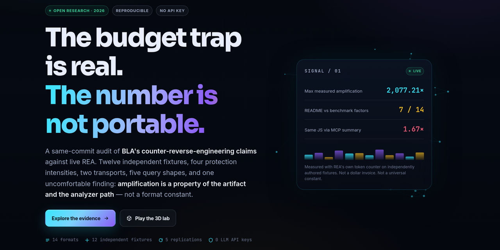](preview.html)

**Canonical environment:** Docker, Node 24.22.1, TShark 4.0.17, WABT 1.0.42, no API key.  
**Pinned upstreams:** BLA `bla-agents 3.2.5` at `9c41bb53b040797e098954c4007425981f3a7a6b`; REA `rea-agents 6.9.0` at `d74549e495c58eb4a560279fd9f05508401ea0a0`.  
**Artifacts:** `artifact/` (pipeline), `data/` (claim extracts), `docs/` (evidence and protocols), `figures/` (four figures), `preview.html` (interactive explainer), `paper/references.bib`.

---

## Executive summary (the 30-second version)

BLA reports roughly **639.5x token** and **304.4x cost** amplification across 14 formats. At the same pinned commit, BLA's own benchmark reports **1067.3x** and **502.9x**; **7 of 14** per-case factors differ; and `bla verify` marks runtime equivalence as `not-tested` while still returning `overallPassed: true`.

On 12 independently authored fixtures at BLA's strongest `bankrupt` preset, live REA produces three outcomes:

- **4 amplified:** JavaScript **111.04x**, WASM **2,077.21x**, EVM **978.6x**, PCAP summary **14.37x**.
- **3 neutral:** SQLite **1.29x**, PTX **1.01x**, ELF **1.01x**.
- **5 refused:** ASAR, safetensors, GGUF, BEAM, PYC. A documented ASAR override turns a **789-token refusal** into **47,243,269 tokens**.

The same protected PCAP costs **1.82x**, **6.42x**, **14.37x**, or **275.4x** depending on the query. The same protected JavaScript costs **7,159,792 CLI tokens** or **4,645 MCP-summary tokens**. Across the eight successful CLI cases, the published factor does not predict the measured factor: log10 Pearson **0.039** (95% CI **[-0.815, 0.765]**), Spearman **-0.048**, claimed geometric mean **1,003.24x**, measured **36.38x**.

**The conclusion:** amplification is a property of the artifact, the analyzer path, and the budget -- not a format constant. The number is real in the right measurement frame. It does not travel.

**For a business reader:** the same protected file can cost 1.82x or 275.4x depending on the question, so a single vendor factor is not a budget forecast. This repository gives buyers and vendors a reproducible way to ask better questions.

[Read the abstract](#abstract) · [See the evidence](#52-independent-fixtures-four-amplified-three-neutral-five-refused-rq1) · [Open the interactive preview](preview.html) · [Reproduce it](#9-reproducibility)

## Choose your path

| If you are... | Start here |
| --- | --- |
| A business or technical decision-maker | [Why this matters commercially](#why-this-matters-commercially) · [Executive summary](#executive-summary-the-30-second-version) |
| A researcher or reviewer | [Abstract](#abstract) · [Method](#4-method) · [Results](#5-results) · [Limitations](#7-limitations) |
| A beginner, student, or interviewer | [🌱 Beginner guide](#-beginner-guide--read-this-and-you-are-a-professional) |
| A defender or security engineer | [Defender economics](#56-defender-economics-rq5) · [Threat model](THREAT-MODEL.md) |
| Here to verify or reproduce | [Reproducibility](#9-reproducibility) · [Data and code](#10-data-and-code-availability) |

---

## Abstract

BLA is a publicly released counter-reverse-engineering protector that inserts
decoys and resource traps into binaries and data formats. Its README reports aggregate
token and cost amplification of roughly 639.5x and 304.4x across 14 formats,
and states that all 14 pass runtime-equivalence checks. We audit those claims at
the same pinned commit and test their external validity with 12 independently
authored, minimal fixtures, live REA, and a Docker-pinned measurement harness.

Three findings emerge. First, BLA's own claim surfaces disagree: the
same-commit benchmark reports 1067.3x token and 502.9x cost amplification, not
639.5x and 304.4x; 7 of 14 per-case factors differ between the README and the
benchmark; and `bla verify` returns `runtimeEquivalence.status: "not-tested"`
and `functionalIntegrityVerified: false` on every protected case while still
returning `overallPassed: true`.

Second, the live outcome is conditional. At the `bankrupt` preset we test,
four cases amplify strongly (JavaScript 111.04x, WASM 2077.21x with preserved
exports, EVM 978.6x, PCAP summary tool 14.37x), three are neutral (SQLite 1.29x,
PTX 1.01x, ELF 1.01x), and five are refused (ASAR, safetensors, GGUF, BEAM,
PYC). A documented REA override turns the ASAR refusal into a 718.14x
amplification. The same protected PCAP costs 14.37x through the summary tool,
1.82x through a narrow field query, 6.42x through a broad field query, and
275.4x when payload fields are requested. The same protected JavaScript costs
7,159,792 tokens over CLI full JSON but 4,645 tokens through MCP summary.

Third, the published factor does not predict the measured factor in this
sample. Across the eight successful CLI cases, log10 Pearson correlation is
0.039 (bootstrap 95% CI [-0.815, 0.765]), Spearman is -0.048, and the log-log
slope is 0.018. The claimed geometric mean is 1003.24x; the measured geometric
mean is 36.38x. A `cl100k_base` sensitivity check leaves the rank conclusion
unchanged but moves individual factors by up to 7x.

The defensible conclusion is not that BLA is ineffective. It is that BLA's
factors are properties of particular protected artifacts and analyzer paths,
not portable format constants. Budget traps are real, but they are
query-shaped, fixture-dependent, and sometimes convert a refusal into a larger
bill. Evaluations that report one factor per format without transport, query,
override, and ABI details are under-specified.

---

## Interactive preview

`preview.html` is a single-file explainer that turns the study into something you can explore: a 3D constellation of all 15 case rows, a five-round budget game, an eight-question quiz, a searchable case table, a concept map with read-aloud narration, reduced-motion support, keyboard navigation, and a text data view for accessibility. It is a communication layer, not a measurement instrument; the canonical numbers remain the JSON files in `artifact/results/`.

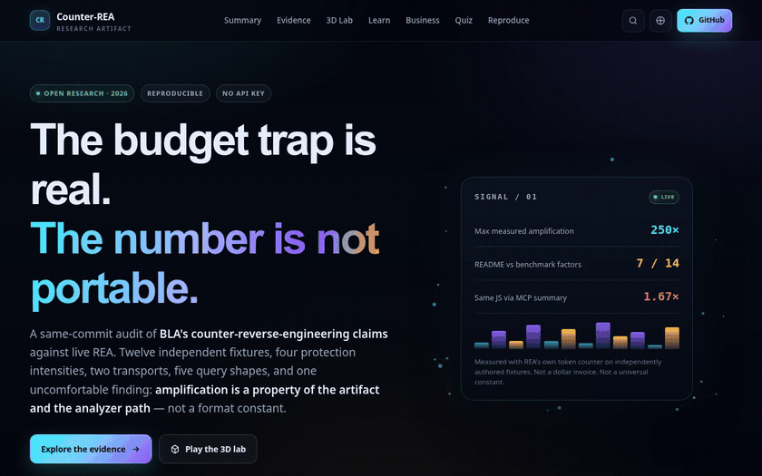

*A short tour: hero, evidence table, 3D lab, Budget Run, quiz, and concept map. A higher-quality MP4 is at [`assets/demo.mp4`](assets/demo.mp4).*

| 3D lab | Evidence table |
| --- | --- |
| 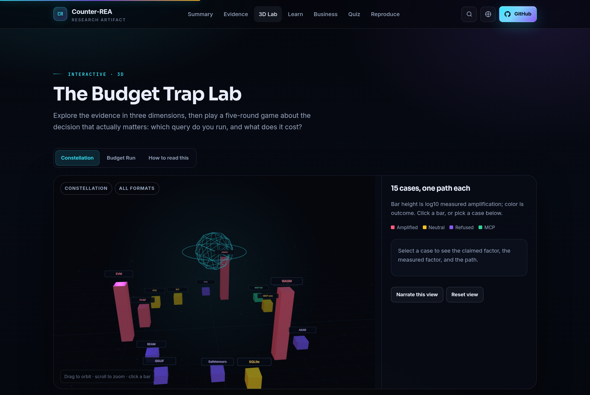 | 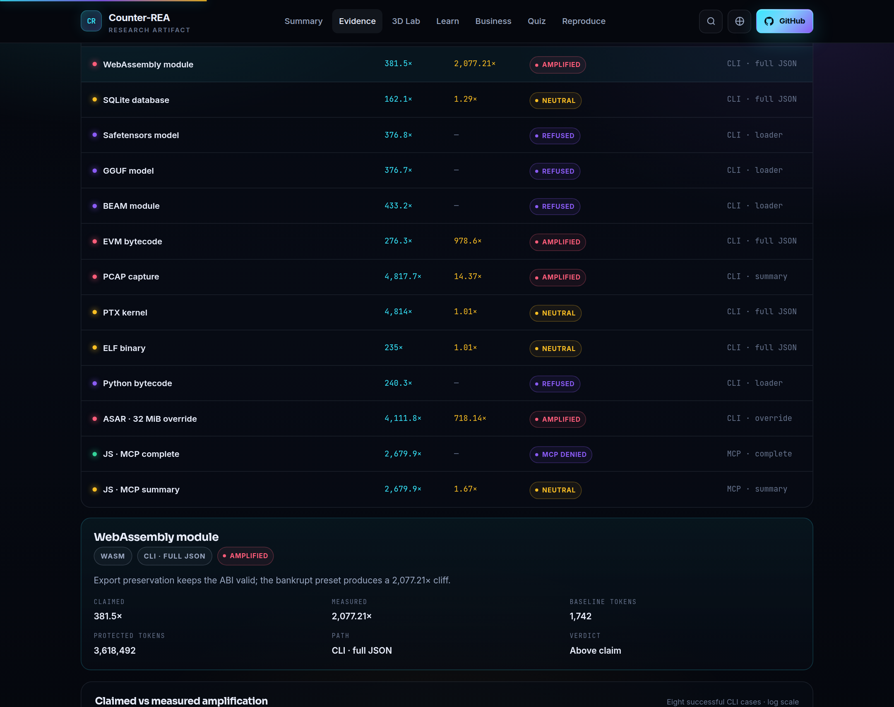 |
| **Quiz** | **Concept map** |
| 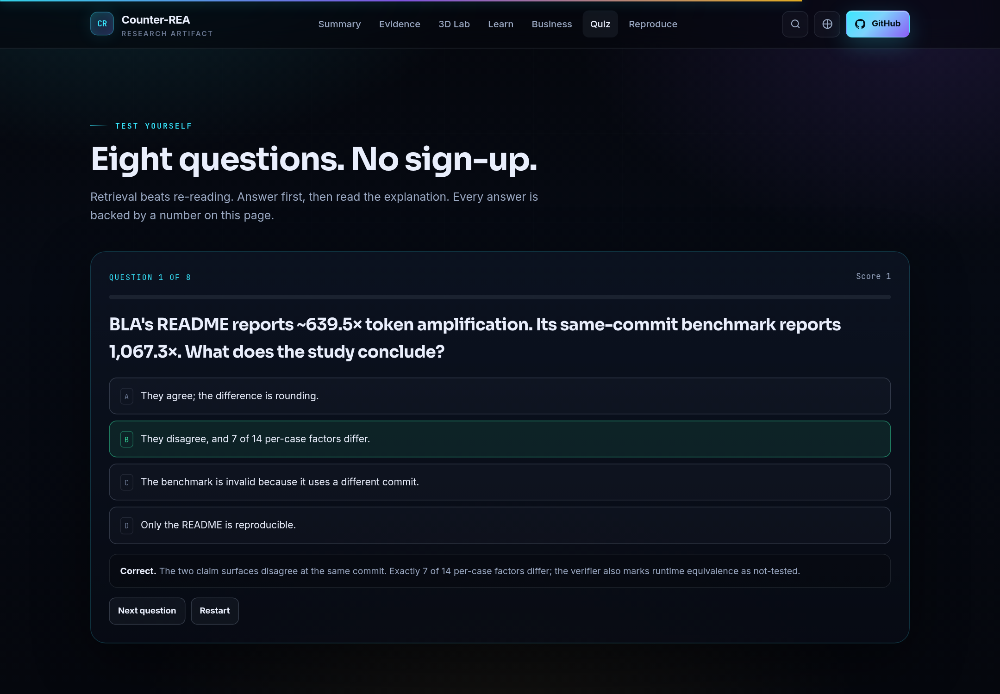 | 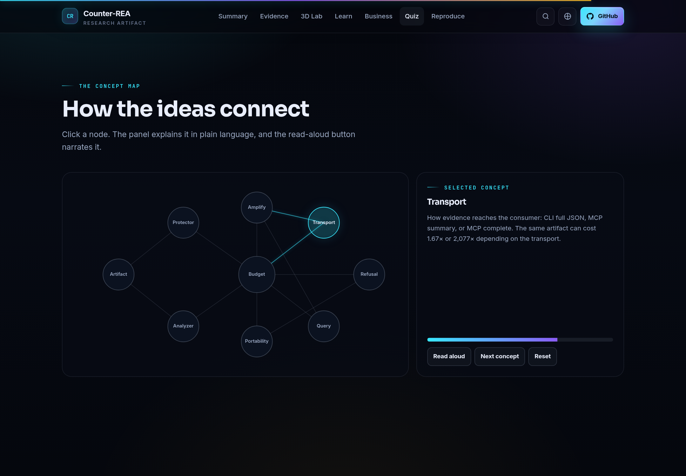 |

<p align="center">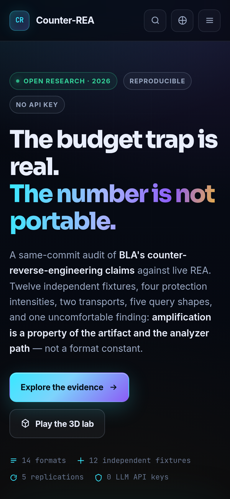</p>

The preview loads Three.js from a CDN for the 3D view. If WebGL or the CDN is unavailable, the page falls back to the accessible data table and the game and quiz still work. `index.html` is a zero-config redirect to `preview.html`; see [Publish the interactive preview](#publish-the-interactive-preview).

## 🌱 Beginner guide — read this and you are a professional

No security background required. Read this once and the rest of the repository will make sense.

**Level 1 — The idea in one sentence.** A protection layer can make an analysis agent spend far more tokens on the same artifact, but the amount depends on how the agent is asked to look.

**Level 2 — The analogy.** Imagine a warehouse with one real filing cabinet and fifty decoy rooms. A careful visitor who opens only the cabinet pays almost nothing. A visitor who searches every room pays a fortune. A visitor who is told "the archive is locked" pays for the trip and goes home. Same warehouse, three different bills.

**Level 3 — What "amplification" means.** Amplification is protected tokens divided by baseline tokens. If an unprotected file produces 1,000 tokens of analyzer output and the protected file produces 100,000, the factor is 100x. It is not a dollar invoice, and it is not a universal property of the format.

Let's work this out in a step-by-step way to be sure we have the right answer. Take the protected PCAP. The analyzer can ask for a one-line summary (14.37x), one narrow field (1.82x), six broad fields (6.42x), or the payload bytes (275.4x). The file never changed. The question changed.

**Level 4 — Three outcomes, not one number.**

| Outcome | Plain English | Why it matters |
| --- | --- | --- |
| **Amplified** | The analyzer succeeded and produced much more output. | The trap worked as a cost multiplier. |
| **Neutral** | The analyzer succeeded and produced about the same output. | The trap did not bite on this path. |
| **Refused** | The analyzer stopped with an error. | This may be a security boundary, a usability problem, or a routing signal. It is not automatically a win. |

**Level 5 — Why one number per format does not travel.** The same artifact can change cost when you change the protector intensity, the transport (CLI or MCP), the output detail, the query, or a documented size limit. Two WASM modules can differ by a few kilobytes and land on opposite sides of a representation threshold. A refusal can become a large bill if the analyst raises a budget.

**Level 6 — What a professional asks next.** Ask six questions before believing any amplification claim:

1. Which exact artifact and protector intensity?
2. Which analyzer command and fields?
3. Which transport and detail level?
4. Which budgets and overrides are in play?
5. Is the program still functionally equivalent, or only structurally valid?
6. Is the unit tokens, bytes, wall time, or dollars?

**You will know more than most interview candidates.** If you can explain the three outcomes, the PCAP query spread, and the CLI/MCP gap, you will be ahead of most practitioners.

## Why this matters commercially

Protection vendors sell a promise: "our artifact costs the attacker N times more." Buyers need to know whether N survives their own tooling, their own query patterns, and their own budgets. This repository is a worked example of how to test that promise without accepting either side's marketing.

### The business problem

- Security budgets are increasingly measured in agent tokens, context windows, and tool time, not only analyst hours.
- A protection claim that is true on a vendor fixture may be false on a customer artifact, a different analyzer, or a narrower query.
- Procurement and technical due diligence rarely get a same-commit, reproducible measurement package they can inspect.

### Who gets value

- **Protection vendors** who want an independent, reproducible stress test before publishing a factor.
- **Buyers and integrators** evaluating counter-reverse-engineering tooling for a product or platform.
- **AI-agent platform teams** that need to reason about context budgets, transport limits, and tool-routing behavior.
- **Security training and research groups** that need a compact, hands-on case study in measurement validity.
- **M&A and supply-chain reviewers** who need to ask better questions about software-protection claims.

### Commercial paths (services, not promises)

The code and data are MIT-licensed. The commercial layer is the work around them; none of the following is a guarantee of savings or protection.

- **Independent claim audits.** Re-run the harness on a customer artifact and report conditional factors with transport, query, and ABI caveats.
- **Procurement diligence.** Turn a vendor's single headline factor into a decision-ready table of amplified, neutral, and refused paths.
- **CI measurement.** Adapt the protocol into a repeatable check that catches claim drift between releases.
- **Workshops and training.** Teach teams why budget traps are query-shaped and how to measure them without overclaiming.
- **Evaluation design.** Help research and product teams specify intensity, transport, budgets, and functional checks before a benchmark is run.

### The questions this repository helps answer

1. Does the published factor reproduce on artifacts we did not author?
2. Which analyzer path is cheapest, and which is most expensive?
3. Does a refusal represent protection, breakage, or a routing signal?
4. What does the claim cost in tokens, and what would it cost in dollars at our own prices?

### What we do not claim

- We do not claim BLA is ineffective. Four default paths amplified strongly.
- We do not claim these factors generalize to all software. The fixtures are minimal and deliberately independent.
- We do not convert tokens into dollars without a stated tokenizer, transport, and price. The primary unit is REA's own token count, not a bill.

## FAQ

**Is BLA ineffective?** No. The study supports a conditional version of BLA's thesis: resource traps can raise analyzer cost by orders of magnitude, but the effect depends on the artifact and the path.

**Are these dollar costs?** No. The primary metric is REA's `--token-count`; it is not a billed invoice and not an LLM tokenizer. `cl100k_base` is a sensitivity check.

**Why 12 fixtures but 14 formats?** The claim audit covers BLA's 14 targets. The independent external-validity test uses 12 authored fixtures; ASAR appears twice because the default refusal and the 32 MiB override are different paths, and the MCP probes add transport variants. The full table has 15 case rows.

**Why is WASM 2,077.21x?** At the `bankrupt` preset the export-decoy flood dominates, and the primary case preserves the `computeDigest` export so the comparison is ABI-valid. Without export preservation the module is not ABI-compatible and is not used for the primary factor.

**Why does the verifier say "not-tested"?** `bla verify` is a structural self-check with scope `counter-rea-structural`; it does not execute the protected program. It returns `overallPassed: true` while `runtimeEquivalence.status` is `not-tested` and `functionalIntegrityVerified` is `false`.

**Is the ASAR refusal a failure?** It is documented REA behavior at the default 16 MiB cap. The same file with the documented 32 MiB override produces a 718.14x amplification, which is the more interesting result: denial can become a larger bill.

**Why do the README and benchmark factors disagree?** They are different surfaces at the same commit. The README is hand-maintained; the benchmark computes its own aggregate; 7 of 14 per-case factors differ. The study treats this as a claim-surface audit, not version skew.

**Does this require an API key?** No. The repository records zero LLM API keys. The agent-in-the-loop experiment remains design-only, and no LLM behavior is inferred from token counts.

**Can I reproduce it?** Yes, with Docker. The canonical run fetches the pinned commits and regenerates the fixtures and results. Host runs are supported but not canonical because path lengths and tool versions change counts.

**Is the interactive preview part of the evidence?** No. It is a communication layer built from the canonical JSON. The numbers in the page are cross-checked against `artifact/results/summary.json`, but the JSON is the source of truth.

**Is this peer-reviewed?** No. It is an independent, retrospectively documented technical study with a reproducible harness. Cite it as such.

## Glossary

**Amplification factor.** Protected analyzer output divided by baseline analyzer output, usually in tokens. Reported only when both runs exit 0.

**Baseline / protected tokens.** REA's token count on the original fixture and on the same fixture after BLA protection.

**Analyzer path.** The exact command, tool, fields, and detail level used to inspect an artifact.

**Transport.** How evidence reaches the consumer, such as CLI full JSON, MCP `detail=complete`, or MCP `detail=summary`.

**Query shape.** Which fields or tables an analyzer requests. The same protected PCAP spans 1.82x to 275.4x across query shapes.

**Budget / override.** A documented size or resource limit. Raising an ASAR cap converts a 789-token refusal into 47,243,269 tokens.

**Refusal.** A nonzero analyzer exit on the protected artifact. The token count is the error payload, not an analysis cost.

**Intensity.** BLA's protection preset: `stealth`, `balanced`, `maximum`, or `bankrupt`.

**ABI / export preservation.** Whether the protected program still exposes the same callable interface. WASM primary results use `--wasm-preserve-exports computeDigest`.

**Structural verifier.** A check of internal invariants that does not execute the protected program.

**Runtime equivalence.** Evidence that the protected program still behaves like the original under execution. The verifier marks this `not-tested`.

**Tokenizer sensitivity.** Re-measuring with a different tokenizer (`cl100k_base`) to see whether a rank conclusion survives. Individual factors can move by up to 7x.

**Fixture.** A small, authored test artifact that isolates one mechanism. These are probes, not a random sample of real software.

**Geometric mean.** The nth root of the product of n factors; used here to summarize multiplicative amplification without letting one huge factor dominate the average.

**Same-commit audit.** Comparing claims and code from one pinned revision so disagreements cannot be explained by version skew.

---

## 1. The question

BLA targets a real failure mode: an automated reverse-engineering agent can be
forced to spend context, tokens, and time on decoys, oversized metadata, or
resource-limit errors. The defensible claim is that careful artifact design can
raise an attacker's analysis cost without breaking the shipped program.

The stronger claims in BLA's README are more fragile:

1. a single aggregate amplification factor;
2. one factor per format;
3. a claim that those factors transfer beyond BLA's own fixtures;
4. a claim that "runtime equivalence" was verified.

We separate these claims. RQ1 asks how much live REA's output grows on
independent fixtures. RQ2 asks whether protected artifacts preserve observable
behavior and what BLA's verifier actually establishes. RQ3 asks how outcomes
change with intensity, analyzer overrides, transport, and query shape. RQ4
audits BLA's own claim surfaces at one commit. RQ5 asks whether the defender's
cost is lower than the measured attacker cost.

## 2. Contributions

- **A same-commit claim audit.** We extract BLA's README table, benchmark
  output, verifier output, and live-REA validation from one pinned commit and
  show that they are not interchangeable. The README aggregate is not the
  benchmark aggregate; 7 of 14 factors differ; the verifier is a structural
  self-check, not a runtime-equivalence oracle.
- **An external-validity test.** We regenerate 12 fixtures from source,
  protect them with the pinned BLA CLI, and run live REA with pinned versions.
  The test is deliberately not a replay of BLA's showcase; it asks whether the
  published behavior survives independent artifacts.
- **A mechanism-level account of brittleness.** We measure the intensity
  curve, the ASAR override that converts denial into amplification, the
  WASM export-preservation requirement, PCAP query-shape sensitivity, the
  SQLite trap's dependence on column evaluation, and the CLI/MCP transport
  gap.
- **Reproducible evidence.** Every number is produced by a script in
  `artifact/scripts/`; canonical outputs are small JSON files in
  `artifact/results/`; the Docker image pins tool versions that change token
  and byte counts.

## 3. Background and related work

BLA is a recent protector built around decoys, fake structures, and resource
limits. REA is a reverse-engineering agent with CLI and MCP transports and
format-specific inspectors for JavaScript, WebAssembly, SQLite, models, EVM,
packet captures, PTX, ELF, BEAM, PYC, and Electron ASAR. Both are fast-moving
software projects, so this study pins exact commits rather than versions
alone.

The result is best read against several research threads. Software-protection
evaluation has long warned that protection strength is not a single number and
that evaluation methodology shapes conclusions [@desutter2024]. Security
replicability work argues for explicit artifacts, pinned environments, and
claims that can be checked rather than inferred [@olszewski2025]. Agent
evaluation work shows that cost and accuracy must be reported together and that
benchmark design can hide routing and tool-use behavior [@kapoor2024].
Reveree makes the related point that a single solve rate hides where an agent
fails and whether a success reflects analysis or recall [@reveree2026].
BinDeObfBench and Tkachenko et al. document how much LLM deobfuscation
performance varies with transformation and context [@bindeobfbench2026;
@tkachenko2025]. Shumailov et al. provide the conceptual analogue for
energy-latency attacks: an input can be optimized to consume resources without
changing the task [@shumailov2020].

Practitioner discussion has focused on routing around protections and on
static de-blinding of protected outputs [@quarkslab2026; @lasik2026]. We do not
evaluate LASIK or any cleanup tool. We test the narrower question of whether
live REA's measured cost matches the published claim under controlled
conditions.

## 4. Method

### 4.1 Pinned systems and canonical environment

| Component | Version / commit |
| --- | --- |
| BLA | `bla-agents 3.2.5`, `9c41bb53b040797e098954c4007425981f3a7a6b` |
| REA | `rea-agents 6.9.0`, `d74549e495c58eb4a560279fd9f05508401ea0a0` |
| Node | 24.22.1 |
| TShark | 4.0.17 |
| WABT | 1.0.42 |
| Python | 3.11.2 with `tiktoken`, `safetensors`, `gguf`, `numpy` |

The canonical run is the Docker image in `artifact/docker/Dockerfile`. Host
runs use `npx node@24.22.1` and are not canonical: host path lengths and
available tools change token and byte counts. All exact values below are from
the Docker run unless a row says "host probe".

### 4.2 Fixtures

`artifact/scripts/make_fixtures.mjs` deterministically creates 12 small
fixtures: a JavaScript application, Electron ASAR, WebAssembly module, SQLite
database, safetensors file, GGUF file, Erlang BEAM module, EVM bytecode, PCAP
capture, PTX module, ELF64 binary, and CPython PYC file. Each fixture isolates
one mechanism and is readable in source form. They are probes, not a random
sample of real software; see `docs/limitations.md`.

The BLA protection intensity is `bankrupt` for the primary table. This is the
most aggressive of BLA's four named presets; we use it deliberately so that
BLA's mechanism has the best chance to produce a large effect. The CLI default
in the absence of a config is `balanced`, so the primary table should be read
as a strongest-preset result, not as default-CLI behavior. The JavaScript/WASM
intensity sweep covers `stealth`, `balanced`, `maximum`, and `bankrupt`. The
WASM primary case and every WASM intensity case use
`--wasm-preserve-exports computeDigest`; protection without that flag renames
the export, and comparing it to the original would not be an ABI-preserving
comparison.

### 4.3 Measurement protocol

For each case:

1. Run REA on the unprotected fixture and record exit code, wall time, maximum
   RSS, output bytes, token count, and full evidence JSON.
2. Protect with pinned BLA at the stated intensity.
3. Run the same REA command on the protected fixture.
4. Run `bla verify` and capture its JSON.
5. Run an independent functional or structural check where a runtime exists.
6. Repeat the token count three times for determinism.

The primary metric is REA's own `--token-count`, which uses `tokenx` 1.3.0.
It is the unit REA exposes to an agent in this harness; it is not a billed
invoice and not an LLM tokenizer. `cl100k_base` is a sensitivity check, not the
primary metric. A ratio is reported only when both runs exit 0. When REA
refuses, the token count is the refusal payload, not the cost of analyzing the
protected artifact.

### 4.4 Outcomes

We use three outcome labels:

- **amplified:** both runs exit 0 and protected/baseline >= 1.5x.
- **neutral:** both runs exit 0 and the ratio is below 1.5x.
- **refused:** REA exits nonzero on the protected artifact.

A refusal is not automatically a defender win. It can be a usability failure,
a routing signal, or a clean security boundary. We report it separately and do
not average it into an amplification factor.

### 4.5 Statistics

The successful CLI cases are paired by fixture but are not a random sample.
We report exact values, Pearson and Spearman correlations on log10 factors, a
bootstrap confidence interval, a log-log regression, and geometric means.
These are descriptive summaries of a deliberately small sample, not population
estimates.

### 4.6 Retrospective disclosure

This is not a preregistered study. The protocol, hypotheses, and every
departure from the initial plan are recorded in `PROTOCOL.md`. The repository
was built after reading BLA's README, benchmark code, and verifier. No LLM API
key was available, so the agent-in-the-loop experiment remains design-only and
no LLM behavior is inferred from token counts.

## 5. Results

### 5.1 BLA's claim surfaces disagree (RQ4)

BLA exposes four different things that are often read as one claim:

| Surface | What it is | Source |
| --- | --- | --- |
| README table | Hand-maintained aggregate and 14 rounded factors | `README.md:228-247` |
| `bla benchmark` | Local 14-case run of BLA's token estimator plus a mixed functional check | `src/engine/benchmark.ts:280-760` |
| `bla verify` | Structural self-check of BLA's simulated REA invariants | `src/engine/verifier.ts:25-209` |
| Live-REA validation | BLA's own probe of its own showcase fixtures | `docs/redteam/empirical-rea-validation.json` |

Only the last surface runs live REA. The README claims 639.5x token and 304.4x
cost amplification. The same-commit benchmark computes 1067.3x and 502.9x.
Across five benchmark repetitions the token aggregate ranged 1065.9-1067.3x
(mean 1067.02x) and cost ranged 502.2-502.9x (mean 502.76x). The README
aggregate is about 40% below the benchmark it describes. It is also not
derivable from its own rounded table: the rounded totals imply 611.6x, the
arithmetic mean of the 14 rounded factors is 824.7x, and their geometric mean
is 458.3x.

Seven of 14 per-case factors differ between the README and the benchmark:

| Target | README | Benchmark |
| --- | ---: | ---: |
| DX-Ball JavaScript | 2822.7 | 3137.7 |
| License validator JavaScript | 2822.7 | 3172.7 |
| PTX | 500.2 | 4814 |
| PCAP | 333.2 | 4817.7 |
| DEX | 313.2 | 1510.5 |
| .NET DLL | 274.8 | 226.3 |
| Apple plist | 211.8 | 277.6 |

The other seven match. This is a same-commit, same-code disagreement, not
version skew. The README's "14/14 runtime equivalence" claim is contradicted by
the verifier's own metadata: `runtimeEquivalence.status: "not-tested"`,
`functionalIntegrityVerified: false`, and
`verificationScope: "counter-rea-structural"` (`src/engine/verifier.ts:185-205`).
All 12 protected cases returned `overallPassed: true` under that structural
scope, including SQLite, PTX, and ELF, where live REA did not fail at all.

BLA's benchmark `functionalCheckPassed` is a separate and mixed signal. It
executes JavaScript and an ASAR harness; for SQLite, safetensors, DEX, BEAM,
EVM, PCAP, and PTX it parses or validates the artifact; for ELF it compares
only the first 64 bytes; for WASM, if the expected export is absent, it calls
an arbitrary exported function (`src/engine/benchmark.ts:289-413`). None of
these is a runtime-equivalence oracle for the protected program.

BLA's own live-REA validation is the most useful evidence in the upstream
repository. It records 13 real pairs and names the exact REA error or budget:
Go buildinfo, Flutter pool, BEAM, EVM, PCAP, safetensors, GGUF, PTX, ASAR,
WASM, SQLite, Electron fuses, and JavaScript. It is credible for BLA's
fixtures, but those fixtures were generated by BLA's own case builders, not
independently authored, and the JSON records budget hits rather than
analysis-quality scores. It also lists Ghidra/Hopper, Frida, LLDB/GDB,
Rizin/Cutter, JADX, the full EVMole worker, SPIR-V/CUDA/AMD objects, and
firmware as unverified.

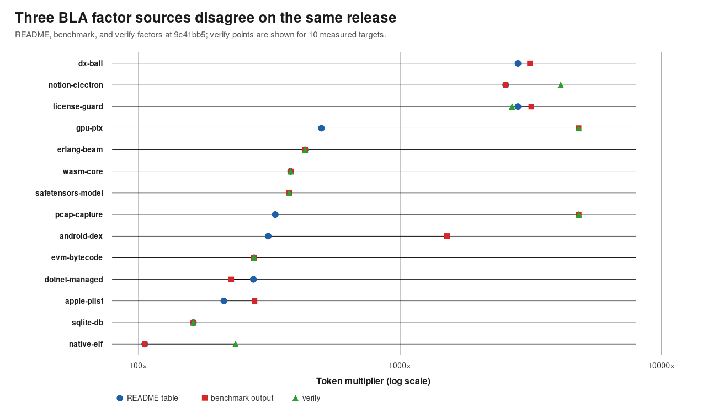

*Figure 1. Three BLA factor sources disagree on the same release across 14
targets. The comparison is same-commit; the disagreement is in the artifact,
not in a version mismatch. Missing verify points mean this study did not
collect a verifier report for that target.*

### 5.2 Independent fixtures: four amplified, three neutral, five refused (RQ1)

The primary CLI results are:

| Case | Baseline tok | Protected tok | Ratio | Outcome |
| --- | ---: | ---: | ---: | --- |
| JavaScript app | 64,481 | 7,159,792 | 111.04x | amplified |
| WASM (preserve exports) | 1,742 | 3,618,492 | 2077.21x | amplified |
| SQLite | 1,308 | 1,684 | 1.29x | neutral |
| EVM | 1,430 | 1,399,400 | 978.6x | amplified |
| PCAP summary tool | 1,063 | 15,279 | 14.37x | amplified |
| PTX | 812 | 817 | 1.01x | neutral |
| ELF64 | 566 | 571 | 1.01x | neutral |
| ASAR, 32 MiB override | 65,786 | 47,243,269 | 718.14x | amplified after override |

Refusals at REA's default CLI settings:

| Case | Baseline tok | Error payload tok | Exit | Error class |
| --- | ---: | ---: | ---: | --- |
| ASAR, default 16 MiB | 65,786 | 789 | 1 | `truncated` |
| Safetensors | 898 | 138 | 1 | `resource_constraint` |
| GGUF | 616 | 4,168 | 1 | `resource_constraint` |
| BEAM | 864 | 196 | 1 | `resource_constraint` |
| PYC | 1,345 | 247 | 1 | `invalid_request` |

The count is 12 formats: four amplified, three neutral, five refused. The
ASAR override row is the same protected file with
`REA_ASAR_MAX_HEADER_BYTES=32 MiB`; it is not a separate format. The default
ASAR refusal at 16 MiB is documented REA behavior, not an artifact defect.

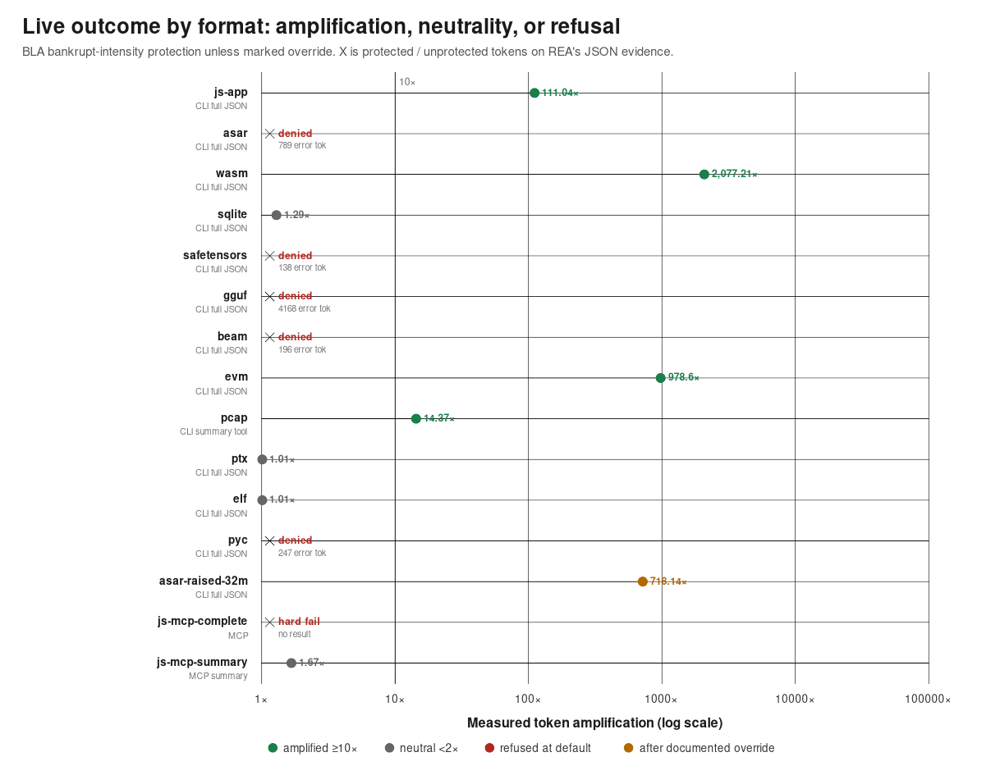

*Figure 2. Live outcome by format at BLA's `bankrupt` intensity. Refusals show
the error payload, not an analysis cost. The ASAR override is marked
separately.*

### 5.3 Equivalence is narrower than the claim (RQ2)

We check observable behavior independently where a runtime exists:

| Case | Independent check | Result |
| --- | --- | --- |
| JavaScript | Four license vectors and a lease call on original and protected code | same outputs |
| WASM (preserve exports) | Three `computeDigest` vectors on original and protected module | same |
| ASAR | Runtime output of rewritten member | same |
| SQLite | Row contents and schema | identical rows, five decoy tables |
| Safetensors | `safe_open` loads tensor data | same data |
| GGUF | Python GGUF reader | 30 fields vs 3; loads |
| EVM | Prefix comparison | byte-identical prefix; 4,190,169 bytes appended |
| PCAP | Five-tuple preservation | original tuple preserved; 160 decoy TCP packets |
| PTX | Prefix comparison | byte-identical prefix; 26,285 bytes appended |
| ELF | stdout/exit and entry point | identical; entry point unchanged |
| PYC | CPython import and execution | executes |
| BEAM | No Erlang runtime installed | not tested |

The WASM primary case preserves `computeDigest`; a protected module without
export preservation renames the export, still makes REA exit 0, but is not
ABI-compatible and is not used for the primary factor. This is a concrete example of why a
token count alone is not an equivalence result.

`bla verify` passed all 12 cases while marking runtime equivalence as not
tested. The independent checks are therefore doing real work: they distinguish
"the analyzer produced a result" from "the protected program still behaves like
the original."

### 5.4 The outcome is brittle to intensity, overrides, transport, and query (RQ3)

**Intensity.** The JavaScript curve is smooth: 38.49x at stealth, 59.31x at
balanced, 91.14x at maximum, and 114.47x at bankrupt. WASM is flat until
bankrupt: 2.74x, 3.91x, 6.67x, then 2077.21x. The bankrupt step multiplies the
previous JavaScript step by 1.26x and the previous WASM step by 311.54x. The
WASM cliff is the export-decoy flood, not a smooth intensity effect. All four
JavaScript and all four WASM variants remained functional in the independent
checks when `computeDigest` was preserved.

**ASAR override.** The protected ASAR header is 18,023,350 B. At REA's default
16 MiB cap the analyzer refuses with `truncated` (789 error tokens). At the
documented 32 MiB override the same file produces 47,243,269 tokens, a 718.14x
amplification. The override is the cleanest example of a denial that becomes a
larger bill when the analyst routes around it.

**Transport.** The same protected JavaScript app produces 7,159,792 tokens over
CLI full JSON. MCP `detail=complete` fails at the 10 MiB stdio budget with a
response of at least 10,577,078 B and no truncation; MCP `detail=summary`
returns 4,645 tokens versus 2,786 unprotected (1.67x). The CLI-to-MCP-summary
ratio is about 1,541x. A paper that reports only "tokens after protection"
without naming the transport is under-specified.

**Query shape.** The same protected PCAP costs 14.37x through REA's summary
tool, 1.82x through a narrow `frame.number` query, 6.42x through six broad
fields, and 275.4x when `tcp.payload` is requested. A full `tshark -T json`
dump grows from 4,049 B to 10,138,437 B, but REA's fixed summary projection
stays within its 8 MiB stream cap. The trap is in the query, not only in the
file.

**SQLite is conditional.** The protected database contains decoy tables
(`enclave_key_hierarchy`, `tpm2_attestation_ledger`, and others). REA's default
inventory lists tables without reading columns and succeeds at 1.29x. Selecting
the trap table or its `unsealed_preview` column triggers
`capability_unavailable` because the read-only connection does not load the
application function `enclave_unseal_payload()`. BLA's "redaction / eval trap"
label is true for a deep column query and false for the default inventory.

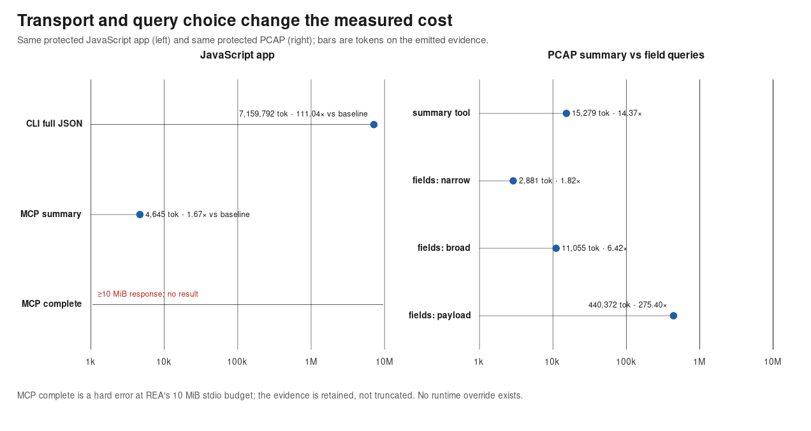

*Figure 3. Same protected JavaScript app (left) and same protected PCAP
(right). The transport and the requested fields change the cost by orders of
magnitude.*

### 5.5 The published factor does not predict the measured factor

Across the eight successful CLI cases, in the order JavaScript, WASM, SQLite,
EVM, PCAP, PTX, ELF, ASAR-override:

- Claimed: `[2679.9, 381.5, 162.1, 276.3, 4817.7, 4814, 235, 4111.8]`
- Measured: `[111.04, 2077.21, 1.29, 978.6, 14.37, 1.01, 1.01, 718.14]`
- Pearson on raw values: -0.3672
- Pearson on log10 values: 0.0393
- Bootstrap 95% CI for log10 Pearson: [-0.8148, 0.7649]
- Spearman: -0.0476
- Log-log slope: 0.0181; intercept 2.9732
- log10 RMSE: 0.6119 for the regression, 2.0385 for a zero model
- Geometric mean claimed: 1003.24x; measured: 36.38x

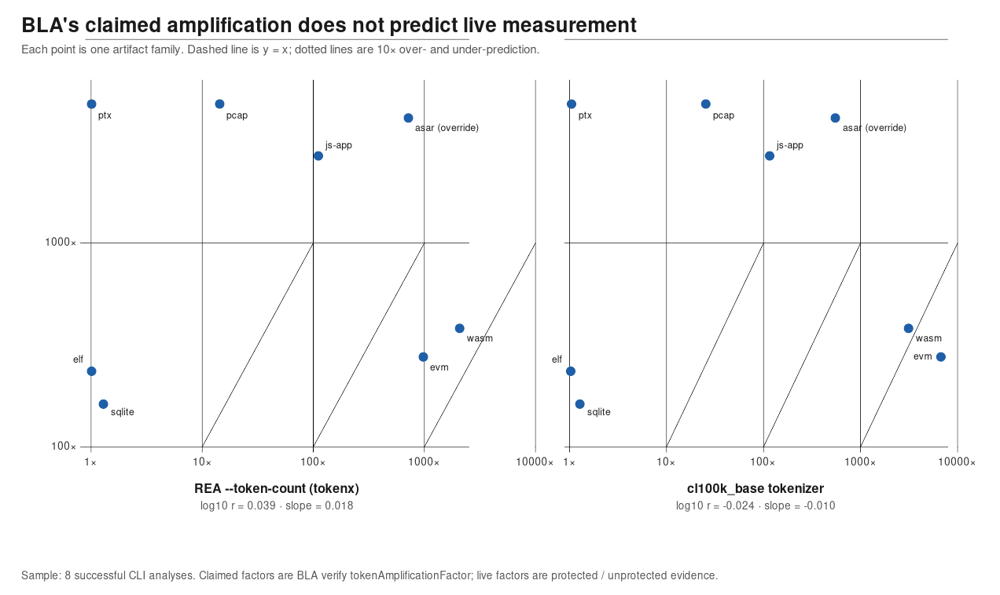

*Figure 4. Claimed versus measured amplification for the eight successful CLI
cases. The dashed line is y = x; dotted lines are 10x over- and
under-prediction. The `cl100k_base` panel is a sensitivity check, not the
primary metric.*

The sample is small and deliberately not random. The correct reading is "no
detectable positive association in this sample," not "the true association is
zero." The claimed/measured ratio ranges from 0.18x (WASM) to 4766x (PTX), which
is enough to show that the published factor is not a portable predictor.

A `cl100k_base` sensitivity check gives measured factors
`[115.64, 3122.9, 1.28, 6732.32, 25.4, 1.05, 1.03, 549.44]`, log10 Pearson
-0.0241, Spearman 0.0476, slope -0.0101, and geometric mean 51.17x. The rank
conclusion is unchanged, but individual factors move by up to 7x. Neither
tokenizer is a dollar cost.

### 5.6 Defender economics (RQ5)

BLA's cost to protect is small: a local CLI run and a mutated artifact. The
attacker's measured cost is large in four default cases (JavaScript, WASM, EVM,
and PCAP summary), small in three (SQLite, PTX, ELF), and undefined in five
where REA refuses without a large token bill; a documented ASAR override
converts one refusal into a fifth large cost. A single ROI number would hide
this distribution. The useful defender question is conditional: which analyzer
path will the attacker actually use, and can the defender tolerate a refusal
that also blocks legitimate tooling?

The refusal cases are not automatically wins. A hard denial can be a security
boundary against one tool, a usability failure for the vendor's own users, or
a signal for the analyst to switch tools. The study reports the asymmetry
rather than collapsing it into one average.

## 6. Interpretation

The results support a conditional version of BLA's thesis. Resource traps can
raise an analyzer's cost by orders of magnitude, and some traps are
surprisingly cheap to build. But the effect is not a format constant. It
depends on:

- the exact protected artifact (a 2.5 KB difference can cross a WASM
  representation threshold);
- the analyzer command and selected fields (PCAP spans 14.37x to 275.4x on one
  file);
- the transport and detail level (CLI 7.16M tokens vs MCP summary 4,645);
- the caller's willingness to raise a documented budget (ASAR 789 error tokens
  vs 47.2M success tokens);
- whether the caller evaluates a trap column or only inventories tables
  (SQLite 1.29x vs `capability_unavailable`).

This is consistent with a routing-around view of agent behavior: an agent that
is blocked on one path may choose another command, a narrower field set, a
summary response, or a higher budget. It is also consistent with Reveree's
argument that solve rate alone is a poor diagnostic; the outcome depends on
where in the pipeline the agent is measured [@reveree2026].

For evaluation practice, the implication is concrete. A claim of the form
"format X costs Nx" is under-specified without the protector intensity, the
analyzer command, the transport, the output detail, the relevant budget, and
the ABI/functional check. A claim of "runtime equivalence" is not established
by a structural verifier or by a parser check that ignores execution. These
are not exotic requirements; they are the minimum needed to compare two
protection evaluations.

## 7. Limitations

The main threats are fixture minimality, single versions of both systems, one
protector intensity for the primary table, path-length-dependent token counts,
and the absence of a live LLM agent. The 12 fixtures isolate mechanisms; they
are not a random sample of real software. A different fixture can move a factor
by orders of magnitude. The WASM result is the clearest example: our 21.5 MB
representation is below REA's 32 MiB cap, while BLA's 2.5 KB smaller module is
rejected. TShark 4.0.17 differs from the 4.4.19 used in BLA's own validation.
No Erlang runtime is installed, so BEAM functional equivalence is untested.

BLA's showcase fixtures are not in the upstream repository at the pinned
commit, so the claimed-vs-measured comparison is not a same-fixture
replication. The README-vs-benchmark disagreement is directly checkable; the
external-validity result is about independent fixtures, not about falsifying
BLA's exact numbers. BLA's own live-REA JSON is credible for BLA's fixtures.

The statistical sample is eight successful CLI cases. The bootstrap interval is
wide and the log-log slope is descriptive. The correct conclusion is "no
detectable positive association in this sample," not "the true association is
zero." Hard denials are not cost amplification; their token counts are refusal
payloads.

Full details, including the exact host/Docker discrepancies and the data-quality
notes, are in `docs/limitations.md` and `docs/measurements.md`.

## 8. Ethics and dual use

All fixtures are synthetic and generated locally. No third-party software is
protected or redistributed. The study evaluates a published defense; it does
not provide a new packer, evasion technique, or weaponized artifact. The most
reusable output is a measurement protocol and a set of negative or conditional
results. See `THREAT-MODEL.md` for the defender/attacker model and non-goals.

## 9. Reproducibility

### Canonical Docker run

```bash
git clone <this-repository>
cd counter-rea-study
cd artifact
docker compose build study
docker compose run --rm study
```

`docker compose run --rm study` fetches the pinned upstream commits, installs
dependencies if needed, builds both tools, regenerates fixtures, and runs the
full pipeline. It requires network access for the upstream fetch and npm
install. The canonical outputs are written to `artifact/results/`.

To rebuild only the paper artifacts after a run:

```bash
cd artifact
node scripts/summarize.mjs
node scripts/statistics.mjs
node scripts/figures.mjs
cd ../figures
for f in *.svg; do convert -density 130 "$f" "${f%.svg}.png"; done
```

PNG conversion uses ImageMagick (`convert`); the SVGs are the source files and
the PNGs are convenience previews.

### Host run

Host runs are supported for development but are not canonical. REA requires a
newer Node than the host default; the scripts use `npx node@24.22.1`. WABT must
be available at `/tmp/opencode/wabt/bin` or via `REA_WABT_BIN_DIRECTORY`.
TShark is required for PCAP probes and is provided by the Docker image.

```bash
cd artifact
bash scripts/fetch_upstream.sh
(cd upstream/bla && npm ci && npm run build)
(cd upstream/rea && npm ci && npm run build:cached)
node scripts/make_fixtures.mjs
node scripts/run_baseline.mjs
node scripts/run_matrix.mjs
node scripts/run_variants.mjs
node scripts/intensity_sweep.mjs
node scripts/verify_equivalence.mjs
python3 scripts/check_models.py > results/model_equivalence.json
node scripts/pcap_probe.mjs
node scripts/sqlite_probe.mjs
node scripts/mcp_probe.mjs js-unprotected "$(pwd)/fixtures/src/app"
node scripts/mcp_probe.mjs js-protected "$(pwd)/fixtures/protected/js-app"
node scripts/mcp_probe.mjs js-unprotected-summary "$(pwd)/fixtures/src/app" analyze_javascript_application summary
node scripts/mcp_probe.mjs js-protected-summary "$(pwd)/fixtures/protected/js-app" analyze_javascript_application summary
node scripts/replications.mjs
node scripts/summarize.mjs
python3 scripts/tokenizer_check.py > results/tokenizer_equivalence.json
node scripts/statistics.mjs
ENV_OUT=results/env.container.json node scripts/provenance.mjs
```

The `Makefile` exposes the same steps (`make setup`, `make fixtures`,
`make matrix`, `make variants`, `make intensity`, `make pcap`, `make sqlite`,
`make mcp`, `make summary`, `make statistics`, `make figures`, `make docker`).

### Publish the interactive preview

No build step is required. `index.html` redirects to `preview.html`, and `.nojekyll` tells GitHub Pages to serve the files as-is.

1. Push the repository to GitHub.
2. Use **Settings → Pages → Deploy from a branch → main → / (root)**.
3. Open `https://<user>.github.io/<repo>/`.

The preview derives the repository URL at runtime, so no fork-specific URL needs editing. The 3D view loads Three.js from jsDelivr; if that request fails, the page falls back to the text data view. For a local check, run `python3 -m http.server 8765` from the repository root and open `http://127.0.0.1:8765/preview.html`.

### Expected outputs

| File | Contents |
| --- | --- |
| `artifact/results/summary.json` / `.md` | Per-case tokens, ratios, outcomes, verifier status, equivalence |
| `artifact/results/statistics.json` | Claimed/measured arrays, correlations, bootstrap, intensity, tokenizer |
| `artifact/results/pcap.json` | PCAP summary and field-query measurements |
| `artifact/results/sqlite_probe.json` | Default inventory and trap-column behavior |
| `artifact/results/tokenizer_equivalence.json` | `cl100k_base` sensitivity |
| `artifact/results/replications.json` | Three repeated JS/WASM/EVM token runs |
| `artifact/results/intensity_equivalence.json` | Four-intensity JS/WASM sweep |
| `artifact/results/model_equivalence.json` | Safetensors/GGUF loader checks |
| `artifact/results/env.container.json` | Canonical environment and fixture hashes |
| `artifact/results/mcp/*.json` | CLI/MCP transport probes |
| `figures/*.svg`, `figures/*.png` | Paper figures |

Token counts are deterministic across the three repetitions; wall time varies
by a few percent. Exact values depend on the pinned tool versions. If a value
does not reproduce, check the commit hashes and the Docker environment before
comparing it to the tables in this README.

## 10. Data and code availability

- `artifact/scripts/` contains every measurement script.
- `artifact/results/` contains canonical small outputs; raw and large evidence
  files are git-ignored.
- `data/` contains machine-readable BLA claim extracts and five benchmark
  repetitions.
- `docs/evidence/bla-claims.md` contains the source-level claim audit.
- `docs/evidence/rea-behavior.md` contains the REA limit and query-shape audit.
- `preview.html` and `assets/` contain the interactive explainer, screenshots, and demo media. They are a communication layer, not part of the measurement pipeline.
- `index.html` and `.nojekyll` support GitHub Pages deployment.
- `PROTOCOL.md` contains the retrospective protocol and hypotheses.
- `THREAT-MODEL.md` contains the dual-use and ethics statement.
- `CITATION.cff`, `LICENSE`, and `DATA-LICENSE` cover citation and reuse.

No LLM API key was used. No live LLM behavior is claimed.

## 11. References

The BibTeX entries are in [`paper/references.bib`](paper/references.bib).

- [@reveree2026] Benkraouda, Cai, Celik, and Wang. "Reveree: Diagnosing LLM
  Reverse-Engineering Agents." arXiv:2609.01185, 2026.
  <https://arxiv.org/abs/2609.01185>
- [@bindeobfbench2026] Hu et al. "Can LLMs Deobfuscate Binary Code? A
  Systematic Analysis of Large Language Models into Pseudocode Deobfuscation."
  arXiv:2604.08083, 2026. <https://arxiv.org/abs/2604.08083>
- [@tkachenko2025] Tkachenko, Suskevic, and Adolphi. "Deconstructing
  Obfuscation: A Four-Dimensional Framework for Evaluating Large Language
  Models Assembly Code Deobfuscation Capabilities." arXiv:2505.19887, 2025.
  <https://arxiv.org/abs/2505.19887>
- [@desutter2024] De Sutter, Schrittwieser, Coppens, and Kochberger.
  "Evaluation Methodologies in Software Protection Research." ACM Computing
  Surveys 57(4), 2024. <https://doi.org/10.1145/3702314>
- [@kapoor2024] Kapoor, Stroebl, Siegel, Nadgir, and Narayanan. "AI Agents
  That Matter." arXiv:2407.01502, 2024.
  <https://arxiv.org/abs/2407.01502>
- [@olszewski2025] Olszewski, Tucker, Butler, and Traynor. "SoK: Towards a
  Unified Approach to Applied Replicability for Computer Security." USENIX
  Security 2025.
  <https://www.usenix.org/system/files/usenixsecurity25-olszewski.pdf>
- [@shumailov2020] Shumailov et al. "Sponge Examples: Energy-Latency Attacks
  on Neural Networks." arXiv:2006.03463, 2020.
  <https://arxiv.org/abs/2006.03463>
- [@bla2026] BLA Contributors. "BLA: Blind LLM Agents," version 3.2.5.
  <https://github.com/qybaihe/bla>
- [@rea2026] REA Contributors. "REA: Reverse-Engineering Agent," version 6.9.0.
  <https://github.com/morluto/rea>
- [@lasik2026] LASIK Contributors. "LASIK: Static De-Blinding for REA
  Output." <https://github.com/pktq/lasik> (not evaluated in this study)
- [@quarkslab2026] Quarkslab. "Defeating AI-Assisted Reverse Engineering, or
  at Least Trying To." 2026.
  <https://blog.quarkslab.com/defeating-ai-assisted-reverse-engineering-or-at-least-trying-to.html>
- [@theregister2026] The Register. "To Thwart Reverse Engineering by Agents,
  Dev Proposes Blinding Them." 2026.
  <https://www.theregister.com/ai-and-ml/2026/11/10/to-thwart-reverse-engineering-by-agents-dev-proposes-blinding-them/5308897>
